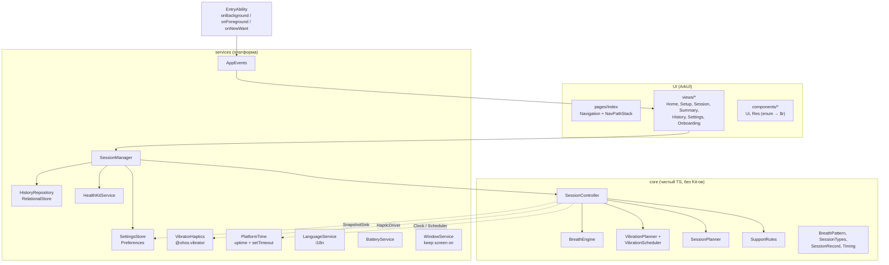

# Архитектура

## Платформа и версии

| | |
|---|---|
| Модель | Stage Model, один модуль `entry` (HAP), `deviceTypes: ["wearable"]` |
| targetSdkVersion | `6.1.1(24)` (HarmonyOS 6.1.1, установлен в DevEco) |
| compatibleSdkVersion (минимум) | `5.0.0(12)`: HarmonyOS 5.0, первый релиз HarmonyOS NEXT на часах |
| Язык / UI | ArkTS, ArkUI (декларативный), state management V1 (`@State`, `@Prop`, `@Provide/@Consume`, `@StorageLink`) |
| Зависимости | Только системные Kit-ы. Сторонних библиотек нет; в dev-зависимостях `@ohos/hypium` (тесты) |

Все API в коде доступны с API 12. Более новые аналоги (например `stopVibrationSync`, API 22) специально не используются.

## Слои



**Главное правило.** `core/` не импортирует ArkUI и Kit-ы. Время (`Clock`, `Scheduler`), моторчик (`HapticDriver`) и сохранение (`SnapshotSink`) приходят в ядро через интерфейсы. Благодаря этому:

- ядро тестируется с `ManualTime`, фейковыми часами, которые идут вперёд только через `advance()`, и тесты получаются детерминированными;
- те же файлы запускаются под Node (`tools/node-test/run.mjs`);
- ядро переносится в lite-JS сборку для Watch Fit без изменений.

## Модели данных

| Модель | Файл | Назначение |
|---|---|---|
| `PhaseType`, `BreathPhase`, `BreathPattern`, `PatternId`, `FreeRhythm` | `core/BreathPattern.ets` | Паттерны и фазы |
| `SessionMode`, `QuestionId`, `Answer`, `Emotion` (12), `Stage`, `SessionStatus` | `core/SessionTypes.ets` | Словарь сессии |
| `PlanStep`, `StepKind` | `core/SessionPlan.ets` | План: intro → дыхание → вопросы → завершающее дыхание → оценка → сообщение |
| `SessionView` | `core/SessionController.ets` | Состояние для UI, только плоские поля |
| `SessionRecord` | `core/SessionRecord.ets` | Строка истории |
| `SessionSnapshot` | `core/SessionRecord.ets` | Всё, что нужно для восстановления после прерывания |
| `AppSettings` | `services/SettingsStore.ets` | Настройки |

## План сессии (`SessionPlanner`)

```
INTRO → BREATH(lead-in) → Q1 → [EMOTION] → BREATH(pause) → Q2 → … → Qn → COMPLETION_BREATH(2–3) → CHECK_IN → MESSAGE → (SUMMARY)
```

- Пауза после вопроса: **2 цикла**, если цикл ≤ 12 с (4-6, 4-2-6, свободный ритм), и **1 цикл** для длинных циклов (4-7-8, квадрат). Если сессия короткая и времени не хватает, пауза сокращается до 1 цикла.
- Завершающее дыхание: 3 цикла, если они укладываются в 60 с, иначе 2. Для всех паттернов это 30–60 с.
- Длительность (2/3/5/7/10 мин) — ориентир. Из неё вычитаются оценки времени на вступление, вопросы, выбор эмоции, оценку, сообщение и завершающее дыхание, а остаток отдаётся на вводное дыхание (минимум 2 цикла). Вопросы и завершение никогда не сокращаются, поэтому при 2 минутах и 4-7-8 практика длится дольше двух минут.
- «Не сейчас» на вопросе 5 сразу ведёт к завершающему дыханию с текстом «Хорошо. Вернёмся к дыханию».
- Ответы ни на что не влияют и никак не оцениваются: «Нет», «Не знаю» и «Пропустить» просто ведут дальше.

## Дыхательный движок (`BreathEngine`)

- Позиция (цикл, фаза, время внутри фазы) **вычисляется из монотонного времени**: `positionAt(pattern, cycles, elapsedMs)`, а не накапливается по тикам. Поэтому опоздавшие таймеры не дают дрейфа; тест `lateTimerDoesNotDrift` проверяет 20 фаз с опозданием каждого таймера на 37 мс.
- Таймер ставится ровно на следующую границу фазы. Если он сработал раньше, движок пересчитывает позицию и ставит его заново.
- `pause()` сохраняет активное время. `resume()` продолжает с того же места внутри фазы и заново посылает `onPhase` с `phaseElapsedMs > 0`, чтобы вибрация и анимация синхронизировались.
- `start(fromElapsedMs)` восстанавливает движок из снимка.
- `completedCycles()` считает только полностью пройденные циклы.
- Монотонные часы: `systemDateTime.getUptime(STARTUP)`. Если пользователь переведёт системное время, практика не сломается.

## Вибрационный движок (`core/Vibration.ets`)

`VibrationPlanner` — чистая функция «фаза → список сигналов». `VibrationScheduler` проигрывает сигналы через `HapticDriver` и умеет отменить всё сразу.

| Фаза | Сигналы (смещение от начала фазы) |
|---|---|
| Вдох *d* с | импульсы по 50 мс в моменты `round(k·1000/3)`, пока *k* < 3·(*d*−1). Для 4 с: 0, 333, 667, …, 2667 (9 импульсов), последняя секунда без вибрации |
| Задержка / пауза *d* с | одиночный импульс в начале секунд 0…*d*−2; в начале последней секунды двойной (50 мс, пауза 110 мс, 50 мс) |
| Выдох | ничего |
| Конец сессии | один импульс 800 мс, после конца завершающего дыхания |

- Пауза, отмена, завершение, уход в фон и смена фазы вызывают `stopAll()`: снимаются все отложенные сигналы и вызывается `vibrator.stopVibration()`.
- При продолжении с середины фазы прошедшие сигналы пропускаются и не «догоняются».
- Если вибрация выключена, сигналы не планируются совсем.
- Интервал 333 мс задаётся таймерами JS-потока поверх `startVibration({type:'time'})`. Точность и ограничения описаны в [LIMITATIONS.md](LIMITATIONS.md#3-вибрация).

Пример 4-7-8: вдох 4 с (частая дробь, тишина на 4-й секунде) → задержка 7 с (импульсы в 0…5 с, двойной в 6 с) → выдох 8 с (тишина) → следующий вдох.

## Оркестрация (`SessionController`)

- Проходит по шагам плана и для дыхательных шагов создаёт `BreathEngine`.
- Подписан на `onPhase` движка, передаёт фазу в `VibrationScheduler` и сообщает UI (`SessionObserver.onUpdate`).
- Считает активное время (без пауз) и сумму циклов.
- Методы `pause / resume / interrupt / discard / shutdown`.
- Сохраняет `SessionSnapshot` через `SnapshotSink` при каждой смене шага и при паузе.
- `fromSnapshot()` восстанавливает сессию **на паузе** ровно в той же точке: шаг, мс внутри дыхательного шага, активное время, циклы, эмоция, оценка.
- `buildRecord(status)` возвращает запись истории. Для `INTERRUPTED` в ней сохраняется `stoppedAt`, то есть этап остановки.

## State management в UI

- `Index` хранит `NavPathStack` и передаёт его через `@Provide('nav')`.
- `SessionPage` получает `SessionView` от контроллера, копирует его в `@State view`, анимирует круг через `animateTo` на остаток фазы. На паузе круг замирает (`animateTo` с длительностью 0 на текущее значение).
- `AppStorage[historyRev]` увеличивается после сохранения, удаления или сброса сессии, и `HomeView` (`@StorageLink` + `@Watch`) перечитывает счётчик «сегодня» и последнюю практику.
- Жизненный цикл: `EntryAbility.onBackground` → `AppEvents.BACKGROUND` → `SessionPage` вызывает `controller.interrupt()` и показывает оверлей «Продолжить / Завершить».

## Навигация

`Navigation` в режиме Stack, корень — `HomeView`; маршруты: `setup`, `session`, `summary`, `history`, `settings`, `onboarding`.

- Setup заменяется на Session (`replacePathByName`), а Session — на Summary, поэтому кнопка «назад» никогда не возвращает в уже пройденную сессию.
- В Session «назад» (жест или кнопка) **не сбрасывает практику**, а открывает диалог «Продолжить / Завершить сейчас / Завершить и сохранить».
- В Onboarding без согласия «назад» закрывает приложение.

Экраны 3–7 (дыхание, вопрос, эмоция, завершающее дыхание, оценка, сообщение) — отдельные полноэкранные представления внутри одного `NavDestination`. Так движок живёт непрерывно, а при переходах между вопросом и дыханием нет анимации стека.

## Хранение: Preferences и RelationalStore

| Данные | Хранилище | Почему |
|---|---|---|
| Настройки, флаг согласия | **Preferences** | Около десяти ключей, синхронное чтение при старте нужно до первого кадра (язык, онбординг) |
| Снимок незавершённой сессии | **Preferences** (JSON) | Один небольшой объект; перезаписывается при каждой смене шага; `flush()` асинхронный |
| История | **RelationalStore** (SQLite) | Запросы «последние 10», «сколько сегодня», «последняя завершённая» выполняются без загрузки всего списка; атомарные вставки; полное удаление одним `DELETE`; индекс по `started_at`; автоочистка до 500 строк |

Всё лежит в песочнице приложения. Ничего не отправляется по сети: в `module.json5` нет разрешения `INTERNET`.

## Локализация

- `resources/base` — русский язык (по умолчанию и запасной), `resources/en`, `resources/es`.
- Режим «Системный»: менеджер ресурсов сам выбирает en или es, а для остальных языков берёт base (русский).
- Ручной выбор: `i18n.System.setAppPreferredLanguage('ru'|'en'|'es')` применяется сразу. Возврат к `'default'` срабатывает после холодного перезапуска, и приложение об этом сообщает.
- Числа и форматы задаются плейсхолдерами в ресурсах (`%d`, `%s`), даты — через `Intl.DateTimeFormat` с системной локалью.
- `tools/check-i18n.mjs` следит, чтобы в `.ets` не было пользовательского текста, ключи и плейсхолдеры совпадали, а строки укладывались в лимиты длины для маленького экрана.

## Безопасность и тон

- Онбординг с дисклеймером и согласием обязателен: без него «назад» закрывает приложение.
- `SupportRules` задаёт одно правило для всего приложения. Оценка 1–2 → поддерживающее сообщение. Оценка 1 или эмоция «Страх» → мягкая рекомендация обратиться к близкому человеку или специалисту; номеров экстренных служб нет, пока неизвестен регион.
- Тексты говорят о принятии эмоции («позволь ей быть»), а не о её подавлении, и не оценивают ответы.
