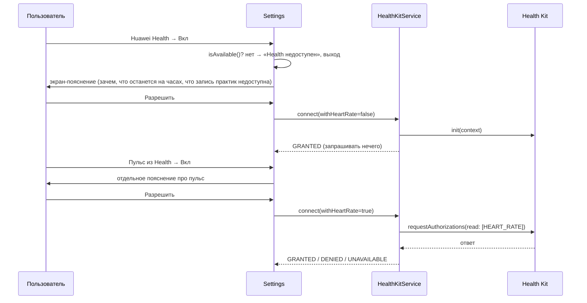

# Health Kit (Health Service Kit), опционально

Приложение полностью работает без Health Kit. Интеграция включается только вручную в *Настройки → Huawei Health*.

## Что проверено в SDK (API 24)

- `@kit.HealthServiceKit` → `healthStore`: `init`, `requestAuthorizations`, `readData`, `saveData`, `cancelAuthorizations`. Доступно с `5.0.0(12)`; syscap `SystemCapability.Health.HealthStore` есть у устройств `wearable`, а у `liteWearable` только `.Lite`.
- **Типа данных для дыхательной или медитативной практики в `healthDataTypes` нет.** Есть `WORKOUT` с подтипами-тренировками, `STRESS`, `EMOTION`, `HEART_RATE` и другие. Если записать практику как тренировку (например `YOGA`), это исказит статистику активности пользователя. Поэтому запись практик **сознательно выключена** флагом `HealthKitService.PRACTICE_WRITE_SUPPORTED = false`, и пользователь видит об этом честное пояснение. Когда Huawei добавит подходящий тип, достаточно реализовать `savePractice()` и включить флаг; вызов уже стоит в `SessionManager.persist()` и выполняется только для завершённых сессий.
- **Пульс** (`samplePointHelper.heartRate`, поле `bpm`) читается за окно `[startedAt, endedAt]` практики. Среднее значение показывается в итоге и сохраняется в локальной истории.

## Поток согласия



- **Отказ** (`DENIED`): переключатель остаётся выключенным, пользователь видит тост «Доступ не выдан. Приложение работает без Health». Повторно разрешение не запрашивается, пока пользователь сам снова не включит переключатель.
- **Недоступно** (`UNAVAILABLE`: нет syscap, нет client_id, сервис не отвечает, нет сети при первичной авторизации): тост «Health недоступен на этих часах».
- **Выключение**: `cancelAuthorizations()`, оба флага сбрасываются.
- Любая ошибка при чтении пульса возвращает `0`, и строка «Пульс» в итоге просто не показывается.

## Что нужно настроить для работы на устройстве

1. В AppGallery Connect: проект → ваше приложение → *Health Service Kit* → подать заявку на доступ и **scope чтения пульса**. Проверьте точный путь в консоли AGC: интерфейс меняется.
2. Скопируйте **client_id** приложения из AGC и раскомментируйте блок `metadata` в `entry/src/main/module.json5`:
   ```json5
   "metadata": [{ "name": "client_id", "value": "<AGC client id>" }],
   ```
3. Подпишите сборку сертификатом, отпечаток которого зарегистрирован в AGC; с автоподписью DevEco Health Kit обычно не авторизуется.

Без этих шагов `connect()` вернёт `UNAVAILABLE`, и приложение продолжит работать без Health.

## Приватность

- Приложение ничего не отправляет по сети, разрешения `INTERNET` нет.
- Пульс используется только для среднего значения в итоге и хранится в локальной истории. Он удаляется вместе с историей.
